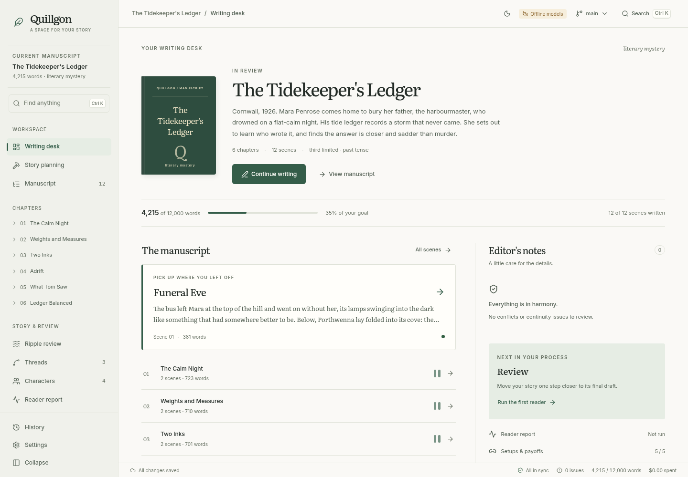
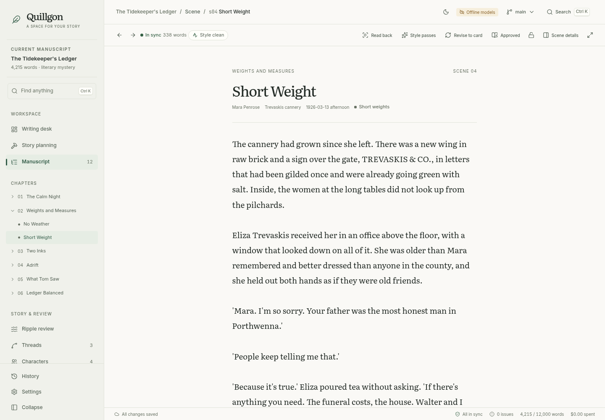
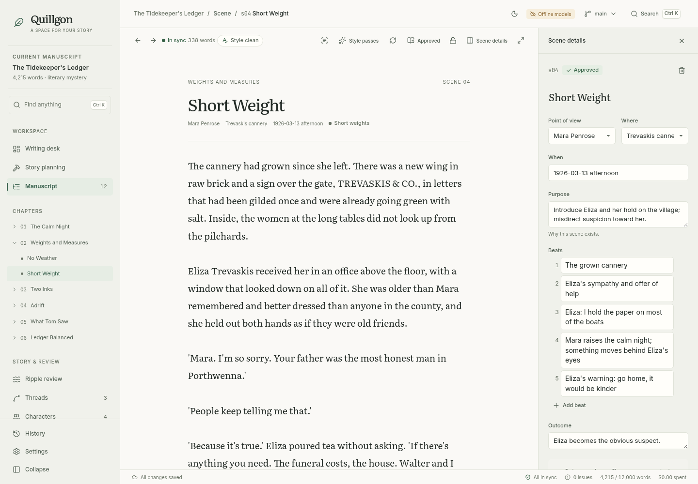
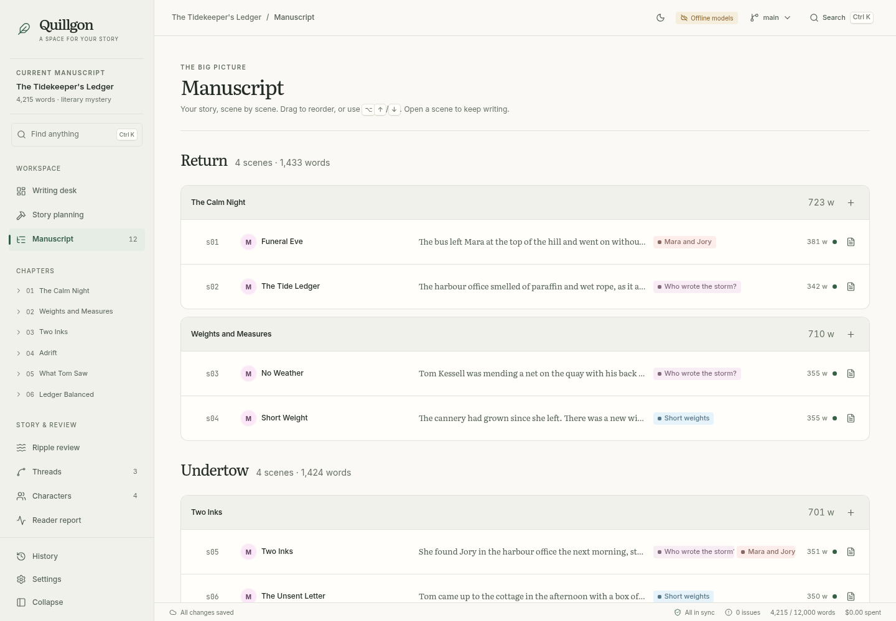
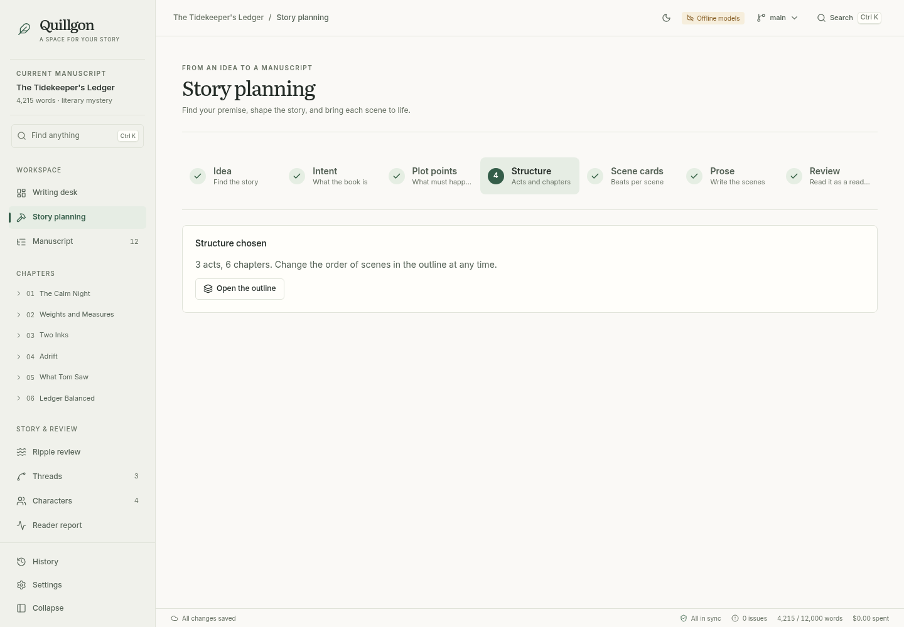
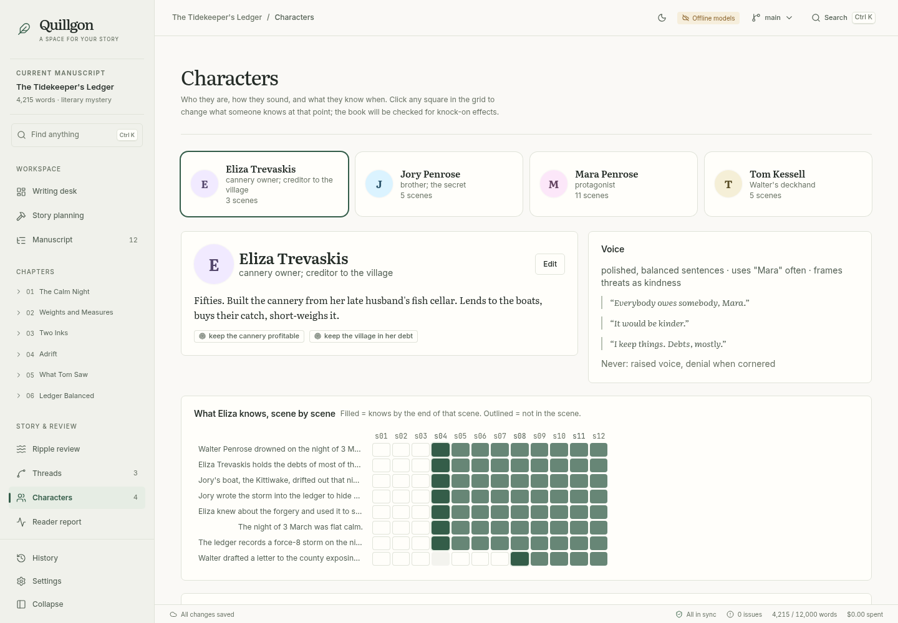
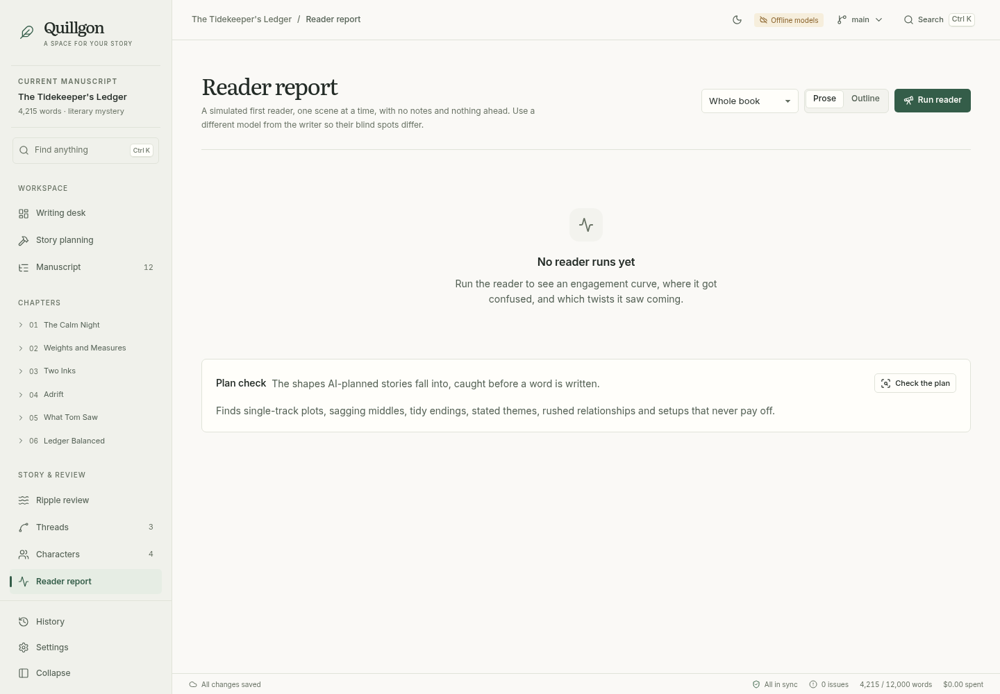
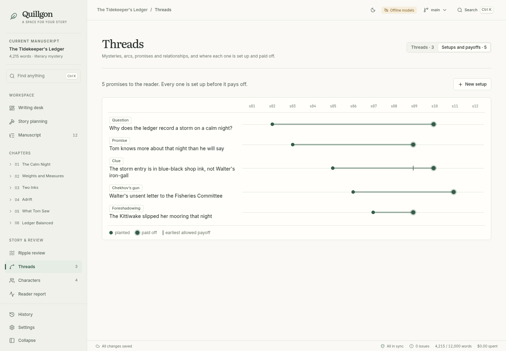
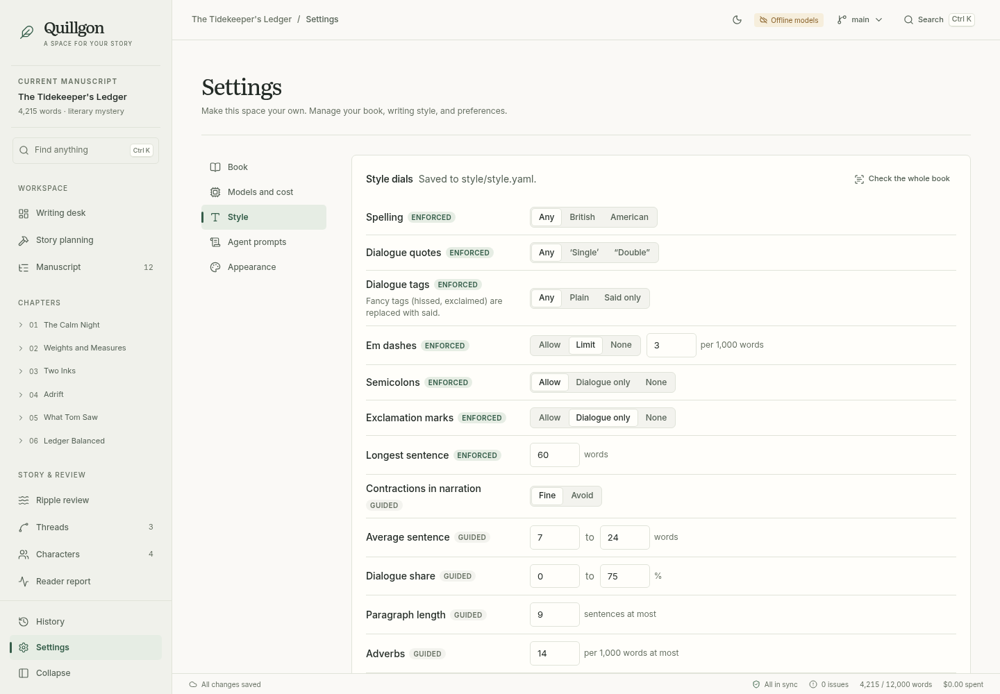

# Quillgon

**A whole novel. Still your story.**

Quillgon is an early-stage, local novel-writing workspace for planning, drafting, and revising with AI. You set the intent, pin plot points, choose between alternatives, and edit anything. It tracks how changes affect scenes, character knowledge, and unresolved threads, then lets you review proposed revisions.

**The story graph is the source; prose is compiled output.** Intent, plot points, threads, character state and scene cards define what is true. Prose is generated from them and can be edited, but every prose edit is read back into the graph so the two never drift.



[Website and writing guides](https://quillgon.vercel.app) · [Download source preview](https://github.com/JeremySNR/quillgon/releases/tag/v0.1.0-alpha.1) · [Get started](https://quillgon.vercel.app/get-started/) · [Report a problem or suggest a feature](https://github.com/JeremySNR/quillgon/issues)

The sample novella and offline workflows are tested. Offline generation uses placeholder text; a complete 80,000-word novel with live models has not yet been validated. Quillgon runs from source. You can build a desktop installer yourself with `pnpm dist` (see [Desktop app and installers](#desktop-app-and-installers)); no installers have been published yet. The website source lives in [`apps/site`](apps/site/README.md).

Quillgon is available under the [MIT license](LICENSE). Contributions are welcome; see [CONTRIBUTING.md](CONTRIBUTING.md).

## Quick start

You need **Node.js 22 or newer**, **pnpm 10**, and **Git**. Clone the repository, then run:

```bash
git clone https://github.com/JeremySNR/quillgon.git
cd quillgon
pnpm install
pnpm build          # build the UI
pnpm serve          # http://127.0.0.1:4317, then "Open the sample novella"
```

For the Electron shell, stop the server and run `pnpm desktop`. It also requires Node.js on your `PATH`. To build an installer instead, see [Desktop app and installers](#desktop-app-and-installers). The app stores books in local Markdown and YAML files; connected AI providers receive relevant story context when you use generation or analysis.

The app works with no API key: choose **Offline** models when you create a book (or set `QUILLGON_OFFLINE=1`). Offline output is placeholder text, but every screen and workflow works.

**OpenAI is the default**, using the Responses API through the official OpenAI SDK. Set `OPENAI_API_KEY` in the environment that launches Quillgon, then restart it. API usage is billed separately from ChatGPT/Codex subscriptions. Models per tier live in each book's `book.yaml`, and you can change them under Settings → Models. Defaults (editable prices in USD per million tokens):

| Tier | Default | Used by |
| --- | --- | --- |
| frontier | `gpt-6.1-sol` | muse, interviewer, planner, writer, reviser, critic, judge |
| mid | `gpt-6.1-sol` | extractor, voice checker, line editor |
| small | `gpt-6-luna` | continuity |
| reader | `gpt-6.1-sol` | simulated reader (another vendor can reduce shared biases) |

### Use your Codex subscription

1. Install the [Codex CLI](https://developers.openai.com/codex/cli), then run `codex login` on the same computer and OS account as Quillgon. Choose **Sign in with ChatGPT** with a plan that includes Codex.
2. Choose **Codex subscription** when creating a book, or in Settings → Models, then save. CLI: `pnpm quillgon init my-book --title "My book" --codex`.
3. Leave the model blank to use your Codex account's default, or enter a model available to your plan.

Quillgon calls the official local [Codex SDK](https://developers.openai.com/codex/sdk). Codex manages sign-in and token refresh; Quillgon does not read or copy your authentication tokens. Each request runs in a fresh empty directory with read-only access, shell and web search disabled, and no MCP servers. The supplied story context is sent to OpenAI. Codex sessions may persist locally under your Codex home.

Your subscription's usage limits, available models, workspace rules, and data policies apply. Quillgon logs token usage with **$0 API cost** for Codex; this does not mean unlimited usage or a free subscription. Authentication or quota errors never fall back to API billing. API credentials are excluded from the Codex child process and ChatGPT authentication is required.

Verification: a short synthetic request through the real Codex SDK and local ChatGPT sign-in succeeded. API adapter behavior is covered by mocked SDK tests; a live Responses API call still needs `OPENAI_API_KEY`. This is not a full-novel quality evaluation.

Anthropic (`ANTHROPIC_API_KEY`) and OpenAI-compatible Chat Completions endpoints remain available per tier. Existing explicit provider settings are preserved. Select **OpenAI API** in Settings to apply the new defaults to an existing book. The [OpenAI model catalog](https://developers.openai.com/api/docs/models) lists current availability and prices; stored prices are estimates rather than invoices.

For development, `pnpm dev` runs the API and the Vite dev server with hot reload on http://localhost:5173.

## Desktop app and installers

`pnpm desktop` runs the Electron shell from your checkout. To build an installer for the computer you are on:

```bash
pnpm install
pnpm dist           # installers in apps/desktop/release/
```

| Platform | Output |
| --- | --- |
| macOS (Apple silicon) | `.dmg` and `.zip` |
| Windows (x64) | NSIS installer (`.exe`) |
| Linux (x64) | `.AppImage` and `.deb` |

`pnpm dist` builds the UI, bundles the server into a single file with esbuild, rebuilds `better-sqlite3` for Electron, and runs electron-builder (see `apps/desktop/scripts/prepare-package.mjs` and `apps/desktop/electron-builder.config.cjs`). The installed app runs that bundled server with its own Electron runtime, so it needs neither Node.js nor the source tree. The `better-sqlite3` rebuild needs a C/C++ toolchain, Python 3 and network access to electronjs.org for the Electron headers. `pnpm -C apps/desktop dist:dir` skips the installer and leaves the unpacked app in `apps/desktop/release/`.

Pushing a `v*` tag runs [`.github/workflows/release.yml`](.github/workflows/release.yml), which builds all three platforms and attaches the installers to a draft GitHub release.

Before you install one:

- **Installers are unsigned unless you configure signing.** macOS builds are only ad-hoc signed, so macOS reports an unidentified developer: Control-click the app and choose **Open** the first time. Windows SmartScreen warns about an unknown publisher. To sign, set electron-builder's variables (`CSC_LINK` and `CSC_KEY_PASSWORD`, plus `APPLE_ID`, `APPLE_APP_SPECIFIC_PASSWORD` and `APPLE_TEAM_ID` to notarize); the release workflow reads them from the repository secrets listed at its top.
- **Git must be installed.** Every book is a Git repository. The `.deb` depends on `git`.
- **API keys come from the environment.** An app started from the Dock, the Start menu or a launcher does not see variables set in your shell profile. Start it from a terminal where `OPENAI_API_KEY` is set (on macOS, `/Applications/Quillgon.app/Contents/MacOS/Quillgon`), or use Offline models.
- **Codex subscription needs a source checkout for now.** The Codex SDK runs the Codex binary from its own npm package, which the installer does not include.
- The installers use Electron's default icon.

Verified so far: on Linux x64, electron-builder produces the AppImage, the `.deb` and the unpacked app, and the packaged app starts its bundled server and shows the UI. Not yet verified: opening a book in an installed build, which needs `better-sqlite3` rebuilt for Electron (the release workflow does this; it could not be done where the packaging was developed), and the macOS and Windows installers, which so far are built only by the release workflow.

## Using it

1. **Build** walks you through six gates, top down:
   1. **Idea** (optional): start from a seed. Four different personas propose what-ifs, loglines, characters and twists, each with its own estimate of how typical it is; the least typical come first, near-duplicates are dropped and anything close to a stock cliché is flagged. You keep or bin each one, add your own, then grow the premise one level at a time (one sentence → one paragraph → one page → the cast, with what each wants, needs, the wound and the lie they believe).
   2. **Intent:** answer a few questions about your premise. Only what's missing is asked.
   3. **Plot points:** pin what must happen; the planner proposes the rest.
   4. **Structure:** pick one of **three** different act/chapter structures (expected, breaks an expectation, wild card). **Critique them first** runs a critic that looks for the shapes AI-planned stories fall into: one storyline, stakes that don't rise, everything resolving at once, a stated theme, a protagonist things happen to.
   5. **Scene cards:** pick one of **two** beat sequences per chapter. Cards record what each scene plants for later and what it pays off.
   6. **Prose:** each scene goes writer → voice check → style sheet → line edit → extraction.
2. **Outline:** drag to reorder. If the new order breaks what characters know, you're offered a ripple.
3. **Scene editor:** the card on the left (simple fields first, the rest under "More"), the prose on the right in a 66-character reading column. Banners show the sync state and tell you what to do next. Every word is checked against your style sheet as you type: broken rules are underlined, and the toolbar chip opens the list. **How predictable is this turn?** asks the model what it would have made happen here; if it guesses your turn, readers will too.
4. **Ripple review:** the change, a blast-radius map of where it lands in the book, the affected scenes (conflicts pinned to the top), and card and prose diffs. Accept or reject each scene. Use `j`/`k` to move, `a`/`r` to decide, `⇧↵` to apply the round. Each applied round is one git commit, and you can revert the whole ripple.
5. **Characters:** a scene-by-scene grid of what each person knows. Click a square to change it; the book is checked for knock-on effects.
6. **Threads → Setups and payoffs:** the obligations ledger. Every clue, promise, question and Chekhov's gun, drawn across the book from where it is planted to where it pays off. The writer is told what to plant, what to pay off and what to keep open; extraction checks the prose actually did it; a setup that never pays off is flagged.
7. **Reader report:** an engagement curve, confusion, runs of boredom, and every twist judged from both sides: was it guessed early, and did it feel fair looking back? Read the **outline** before any prose exists to catch a guessable twist when it's cheap to fix. The **plan check** runs the structural critic on the whole book.
8. **Settings → Style:** the style sheet (`style/style.yaml`) as dials. **Enforced** rules (spelling, quotes, dialogue tags, em dashes, semicolons, never-words, preferred words, sentence length) are checked by code on every word after every draft; deterministic ones are fixed outright, the rest go to a line editor that proposes span-level edits, and an edit is kept only if code confirms it fixed something without breaking anything, or a judge prefers it in **both** orders. **Guided** rules (rhythm, dialogue share, adverbs, filter words) are measured and nudged. **Set the dials from these** measures your voice samples; **Learned from your edits** turns changes you keep making by hand into rules you can accept.

`⌘K` / `Ctrl K` opens the command palette (every scene, character, thread and action). `⌘\` collapses the sidebar, `⌘.` enters focus mode, and `⌘1`–`⌘7` switch views. The **what-if** menu in the top bar creates, compares and merges git branches.

| | |
| --- | --- |
|  |  |
|  |  |
|  |  |
|  |  |

## CLI

The same engine, headless. `quillgon` lives at `packages/cli/bin/quillgon.mjs`; `pnpm quillgon <command>` also works.

```
quillgon init <dir> [--title T] [--words 12000] [--offline]
quillgon validate [dir]                 schema + reference check with file/field-precise errors
quillgon status | sync | log | costs
quillgon spark ["seed"] [--genre G]     idea → premise: diverge, keep/bin, logline → synopsis → cast
quillgon intent | plan | cards <chapter|all> [--default] | write <scene|chapter|all>
quillgon ledger                         setups and payoffs, and what is unpaid
quillgon style [check|learn|fit]        check prose against style.yaml; rules from your edits; dials from samples
quillgon critique [--scene s05]         plan critic, or how predictable one scene's turn is
quillgon impact <entity>                preview what a change touches (no model calls)
quillgon change <entity>                edit in $EDITOR → impact → card diffs → prose diffs → commit
        entity: scene:s04  state:mara@s04  thread:ledger  plot:pp-drowning  character:mara  structure
quillgon extract <scene>                read a hand edit back; "your edit changed these facts"
quillgon ripple [revert|abandon|list]
quillgon read [--act act-1] [--outline] | check [--mechanical] | voice | estimate
quillgon export [--format md|docx|epub]   (docx/epub need Pandoc)
quillgon branch [name | switch <b> | merge <b> | delete <b>]
quillgon serve [--dir book] [--port 4317]
```

Pass `--yes` to accept the defaults at every gate (useful for scripting), or `--record <dir>` / `--replay <dir>` to record model responses as test fixtures or replay them.

## Architecture

```
apps/desktop/        Electron shell + React/Vite UI (talks to the server over HTTP + SSE)
packages/core/       schemas, graph store, SQLite index, impact analyser, sync,
                     pipeline, ripple engine, quality checks, git
packages/agents/     nine agents (prompt.md + schemas), model adapter, offline suite
packages/server/     local JSON API, background jobs, file watching
packages/cli/        the `quillgon` command
fixtures/novella/    "The Tidekeeper's Ledger": 12 scenes, 4 characters, 3 threads, 2 plot points
```

- **The local API is locked to the app.** The server binds to 127.0.0.1 and requires a per-launch token on every API request; the UI reads it from the page the server serves. Requests with a non-loopback `Host` (DNS rebinding) or a foreign `Origin` are refused, request bodies must be JSON, and git refs from the UI are validated before they reach git. Set `QUILLGON_TOKEN` to choose the token yourself, for example to script against `pnpm serve`. A book's `api_key_env` must name a variable ending in `_API_KEY`, so a shared book file cannot send another secret to a model endpoint.
- **Only the graph store writes to the manuscript.** Agents return structured output, validated with Zod, and the store writes files, updates the index and commits.
- **A book is a git repo of Markdown and YAML** (`book.yaml`, `intent.md`, `plot-points/`, `threads/`, `characters/<id>/{bio.md,voice.md,state.yaml}`, `scenes/<id>/{card.yaml,prose.md,facts.yaml}`, `obligations/`, `idea.yaml`, `structure.yaml`, `timeline.yaml`, `style/` (samples, banned patterns, `style.yaml`), `reports/`). You can edit any of it in another editor; the app reloads.
- **The index is disposable.** `.engine/index.sqlite` holds entities, references, facts and scene embeddings. Delete it and it rebuilds. Embeddings are local and deterministic (hashed term vectors), so impact analysis needs no network.
- **Sync** compares the card hash the prose was generated from with the prose hash at its last extraction. The result is `in_sync`, `card_ahead`, `prose_ahead` or `conflict`, and a conflict blocks generation.
- **Impact analysis** walks references, facts and per-scene state. Hop 0 is the edited scene, hop 1 a direct reference, hop 2 a thread or character state, and hop 3 similarity only (listed, never proposed). Locked scenes become conflicts with three choices: unlock, keep (recorded in `reports/known-inconsistencies.md`), or revert.
- **Model adapter:** `complete(messages, schema, options) → parsed object`. OpenAI Responses streams structured JSON with the configured reasoning effort and `store: false`. Schemas containing arbitrary-key records use JSON mode and local validation. The adapter validates with Zod and re-prompts with validation errors up to twice. Codex subscription uses the local Codex SDK; Anthropic and compatible endpoints are optional. Every completed call is logged to `reports/costs.jsonl`, including cache tokens and estimated API cost.
- **Judges never see one order only.** Any comparison (a line edit against the original, two candidates) is judged twice with the texts swapped; a split verdict is a tie and the original stays. An OpenAI-compatible backend is included for other vendors.
- **Prompts are Markdown** (`packages/agents/src/agents/<name>/prompt.md`). Edit them in the app; overrides are saved to `prompts/<agent>.md` in the book. The intent and its hard rules are always in the system prompt.

## Tests and acceptance

```bash
pnpm test           # 94 unit/integration tests, no model calls
pnpm e2e            # drives the real UI in Chromium (offline models)
pnpm screenshots    # regenerates docs/screenshots
pnpm typecheck
pnpm test:live      # live-model tests; needs QUILLGON_LIVE=1 and an API key
```

| Phase | Status |
| --- | --- |
| 1. Schemas and store | ✅ Fixture validates; 12 kinds of corruption reported with exact file and field; index rebuild matches its snapshot |
| 2. Impact analyser | ✅ 15 named changes with expected affected sets; removing Mara's `knows` fact in s04 flags exactly the later scenes where she speaks of it |
| 3. Adapter and extractor | ✅ Adapter: retries, cost logging, tier routing, record/replay. Extractor: scoring harness and contradiction flagging tested with scripted output. ⏳ The live 90% accuracy run (`extractor.live.test.ts`) needs an API key and has not been run |
| 4. Pipeline via CLI | ✅ Every gate end to end with offline models; result validates, all scenes in sync, reader run completes. ⏳ A 10–15k-word live novella has not been generated yet |
| 5. Ripples | ✅ Plot-point change touches the expected scenes, a locked scene raises a conflict, and continuity is clean afterwards; a prose edit that changes a fact triggers the right ripple; cascade cap; full revert |
| 6. Quality systems | ✅ Planted twist: early guesses detected with how early; a hand-made knowledge error is caught; incremental model-assisted continuity |
| 7. UI views 1–3 | ✅ Browsed and edited in Chromium; also smoke-tested in Electron |
| 8. UI views 4–6 | ✅ `scripts/e2e-ui.ts` completes the phase 5 ripple scenario entirely in the UI, accepting and rejecting individually |
| Research additions | ✅ Obligations ledger (fixture ledger complete; dangling, early and out-of-order payoffs flagged; obligation changes ripple), style sheet (enforced spans, deterministic fixes, repair rounds rejected when they add violations or lose a both-ways judge, rules learned from edits), both-ways judging removes position bias, predictability test, outline reader with two-sided twist verdicts, idea stage (personas, dedupe, cliché flags, Snowflake expansion). See [docs/research.md](docs/research.md) |
| 9. Full novel | ⏳ Needs live models: generate 80k+ words, then tune context scoping, caps and prompts against what breaks |

## Notes and deviations from the plan

- **OpenAI Responses API and Codex SDK.** Quillgon owns the story graph and review workflow; each writing agent requests a structured result through the official OpenAI SDK. A hosted Agents API execution environment is unnecessary for these calls. The local Codex SDK provides a separate path for users signing in with ChatGPT.
- **Electron runs the core as a separate process.** From a checkout (`pnpm desktop`) it is a plain Node process running the CLI through tsx, so `better-sqlite3` needs no Electron rebuild; it needs `node` on your `PATH` (or set `QUILLGON_NODE`). An installed app runs the bundled server with Electron's own Node (`ELECTRON_RUN_AS_NODE`) and a `better-sqlite3` rebuilt for it. Either way the window only shows the server's own pages: other navigation is blocked, web and mail links open in your browser, permission requests are denied, and if the server stops the app offers to restart it.
- **Reader prediction matching is mechanical** (embedding similarity, synonym folding, and the prediction must name the right person). A cheap model judge would be more accurate and is an easy swap.
- **Two small additions to the data model:** `scenes/<id>/facts.yaml` holds extracted facts, so the index can rebuild from files, and an optional `locations.yaml` / `facts.yaml` glossary gives ids human-readable names.

The UI design follows the research brief in [docs/design.md](docs/design.md).
